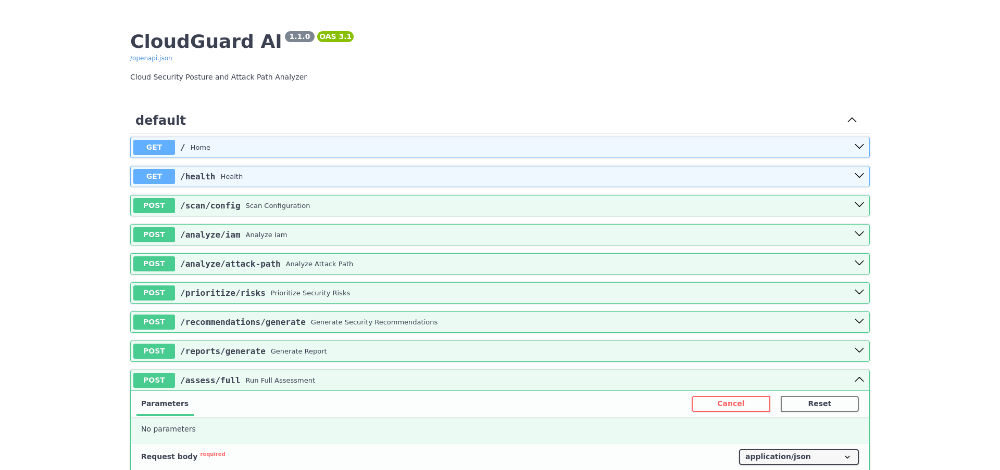
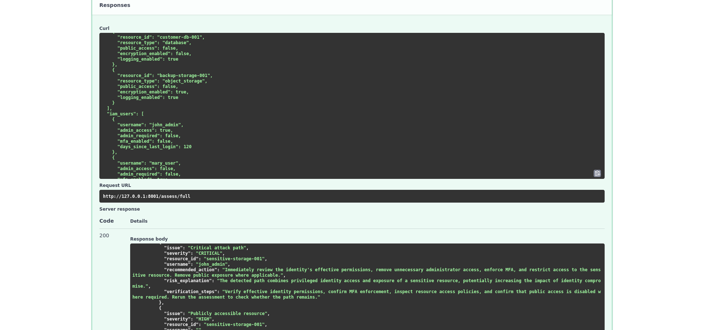
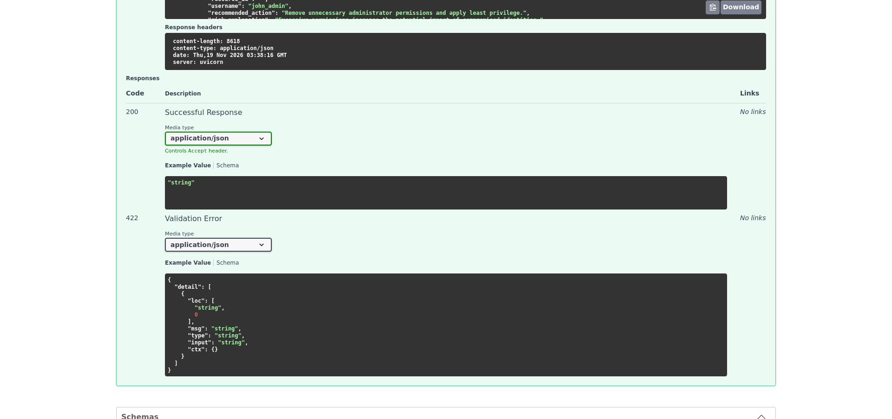

# CloudGuard AI

**Cloud Security Posture and Attack Path Analyzer**

CloudGuard AI is a Python-based cybersecurity project designed to assess cloud configuration risks, identify IAM security weaknesses, detect potential attack paths, prioritize security findings, and generate remediation recommendations.

The project demonstrates an integrated cloud security assessment workflow using Python, FastAPI, automated security analysis modules, and security reporting.

## Project Overview

CloudGuard AI combines multiple security assessment components into one API-driven platform.

Its objective is to help security analysts identify misconfigurations, excessive privileges, insecure resource exposure, and potential paths to sensitive data.

The platform includes a web-based security dashboard for reviewing assessment results and downloading PDF reports.

## Key Features

- Cloud configuration security scanning.
- IAM privilege and account security analysis.
- Attack path detection using explicitly supplied identity-resource relationships.
- Security risk prioritization.
- Automated remediation recommendations.
- Full security assessment through a single API endpoint.
- Automatic timestamped JSON report generation.
- PDF security assessment report generation.
- Interactive security dashboard.
- Assessment history and report downloads.
- Automated testing with Pytest.

## Architecture

```text
                 CloudGuard AI
                       |
                       v
                FastAPI Application
                       |
          +------------+------------+
          |            |            |
          v            v            v
      Cloud Scan   IAM Analyzer   Attack Path
          |            |            |
          +------------+------------+
                       |
                       v
              Risk Prioritization
                       |
                       v
             Recommendation Engine
                       |
                       v
                Report Generator
                       |
                +------+------+
                |             |
                v             v
            JSON Reports   PDF Reports
                |
                v
           Security Dashboard
```

## Technology Stack

| Technology | Purpose |
|---|---|
| Python | Core application |
| FastAPI | REST API |
| Pydantic | Request validation |
| Uvicorn | API server |
| Boto3 | AWS SDK dependency for future integration |
| ReportLab | PDF report generation |
| Pytest | Automated testing |
| JSON | Assessment data and reports |
| Linux / Kali Linux | Development environment |

## Project Structure

```text
CloudGuard-AI/
|
├── app/
│   ├── analyzers/
│   │   ├── attack_path.py
│   │   ├── iam_analyzer.py
│   │   ├── recommendation_engine.py
│   │   └── risk_prioritizer.py
│   │
│   ├── scanners/
│   │   └── cloud_config.py
│   │
│   ├── reports/
│   │   ├── report_generator.py
│   │   └── pdf_generator.py
│   │
│   └── main.py
│
├── dashboard/
│   └── index.html
│
├── data/
├── docs/
│   └── screenshots/
├── reports/
├── tests/
│   └── test_api.py
│
├── requirements.txt
├── README.md
└── .gitignore
```

## Security Assessment Modules

### 1. Cloud Configuration Scanner

Checks supplied cloud resource configurations for:

- Publicly accessible storage.
- Disabled encryption.
- Disabled security logging.

### 2. IAM Security Analyzer

Identifies:

- Excessive administrator privileges.
- Disabled multi-factor authentication.
- Inactive user accounts.

### 3. Attack Path Analyzer

Identifies potential paths between explicitly associated identities and sensitive resources.

The current implementation uses supplied identity-resource relationships rather than automatically calculating complete effective permissions.

### 4. Risk Prioritization Engine

Assigns severity-based risk scores:

| Severity | Score | Priority |
|---|---:|---|
| CRITICAL | 100 | IMMEDIATE |
| HIGH | 75 | URGENT |
| MEDIUM | 50 | MODERATE |
| LOW | 25 | LOW |

These are rule-based prioritization scores, not probabilities of exploitation.

### 5. Recommendation Engine

Generates remediation recommendations and verification steps for detected security findings.

### 6. JSON and PDF Report Generation

CloudGuard AI generates timestamped JSON reports containing:

- Assessment summary.
- Cloud configuration findings.
- IAM analysis.
- Attack path results.
- Risk prioritization.
- Remediation recommendations.

The PDF generator converts saved JSON assessments into structured security reports containing assessment information, findings, attack paths, and remediation recommendations.

PDF reports can be downloaded through the API or directly from the dashboard.

### 7. Security Dashboard

The interactive dashboard provides:

- Critical, high, and medium finding counts.
- Assessment summary.
- Prioritized security findings.
- Detected attack paths.
- Remediation recommendations.
- Recent assessment history.
- PDF report download links.

## Installation

Clone the repository:

```bash
git clone https://github.com/cybertraining07/CloudGuard-AI.git
```

Navigate into the project directory:

```bash
cd CloudGuard-AI
```

Create a virtual environment:

```bash
python3 -m venv venv
```

Activate it:

```bash
source venv/bin/activate
```

Install dependencies:

```bash
pip install -r requirements.txt
```

## Running the Application

Start the FastAPI server:

```bash
uvicorn app.main:app --reload --port 8001
```

Open the following addresses in your browser:

**API documentation**

http://127.0.0.1:8001/docs

**Security dashboard**

http://127.0.0.1:8001/dashboard

**Health endpoint**

http://127.0.0.1:8001/health

## API Endpoints

| Method | Endpoint | Description |
|---|---|---|
| GET | `/` | Project information |
| GET | `/health` | Health check |
| POST | `/scan/config` | Cloud configuration scan |
| POST | `/analyze/iam` | IAM analysis |
| POST | `/analyze/attack-path` | Attack path analysis |
| POST | `/prioritize/risks` | Risk prioritization |
| POST | `/recommendations/generate` | Generate recommendations |
| POST | `/reports/generate` | Generate JSON security report |
| POST | `/assess/full` | Complete security assessment |
| GET | `/dashboard` | Interactive security dashboard |
| GET | `/dashboard-data` | Dashboard assessment data |
| GET | `/reports/pdf/{filename}` | Generate and download PDF report |

## Running Tests

Run the complete test suite:

```bash
python -m pytest -v
```

### Current Test Results

Latest development test run:

- **33 tests passed.**
- **0 tests failed.**
- PDF report download endpoint tested.
- Dashboard endpoint tested.
- Dashboard data endpoint tested.
- Full assessment integration tested.

## Example Use Case

A simulated cloud environment contains:

- An administrator identity with excessive privileges.
- MFA disabled for the administrator.
- Publicly accessible storage.
- Sensitive data stored in that resource.

CloudGuard AI analyzes the supplied configuration and identity-resource relationships, detects potential security risks, prioritizes findings, and generates remediation recommendations.

The assessment results are saved as JSON and can be exported as PDF reports.

## Security Limitations

This project currently operates using supplied assessment data and local simulated environments.

It does not yet perform live AWS or Azure security assessments, automatically retrieve effective IAM permissions, or independently verify real-world attack paths.

Risk scores are rule-based severity values rather than calibrated exploitation probabilities.

The current implementation should be considered a security assessment prototype, not a production cloud security platform.

Only use the platform against systems and environments for which you have authorization.

## Future Development Roadmap

- AWS security assessment integration using Boto3.
- Azure cloud security integration.
- Automated cloud IAM policy analysis.
- Advanced attack graph modeling.
- CVSS-informed risk scoring.
- SIEM and SOC workflow integration.
- AI-assisted security finding analysis.
- Additional cloud security assessment capabilities.

## Project Purpose

CloudGuard AI is a practical cybersecurity portfolio project demonstrating Python development, API engineering, cloud security concepts, IAM analysis, attack-path modeling, automated security testing, dashboard development, and security reporting.

**Project Status:** Active Development

**Version:** 1.2.0

## Screenshots

### API Documentation



### Full Assessment Endpoint



### Full Security Assessment Results


